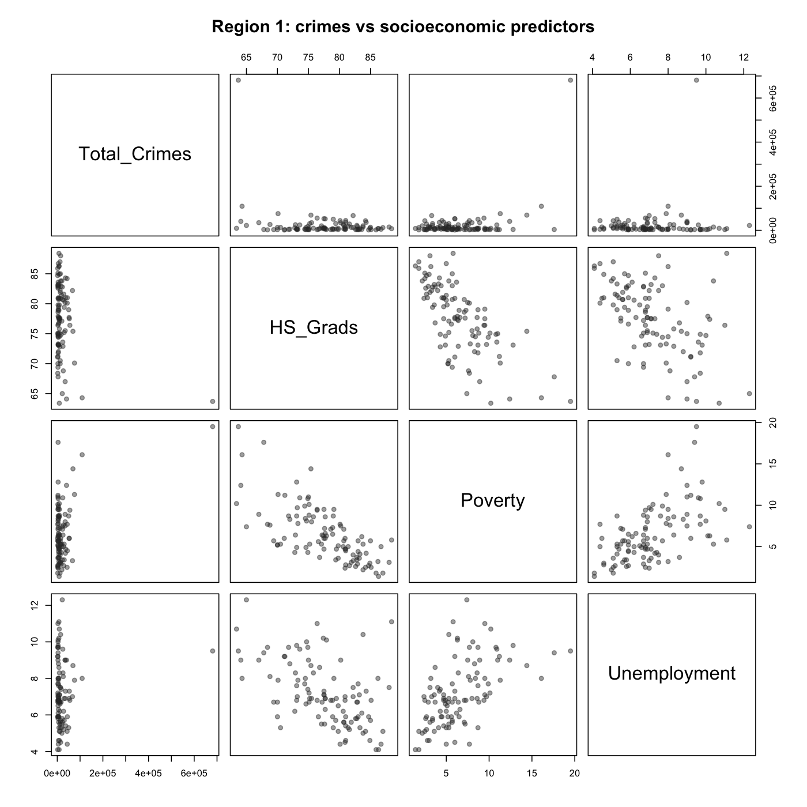
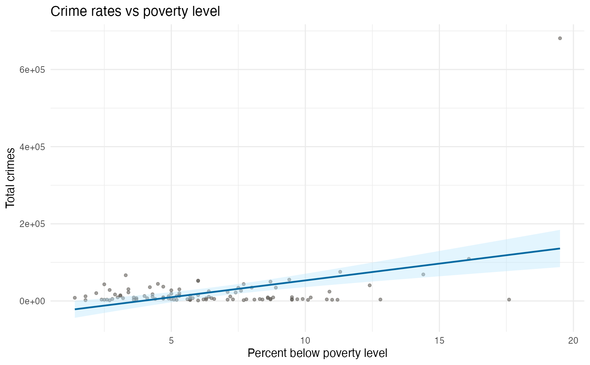
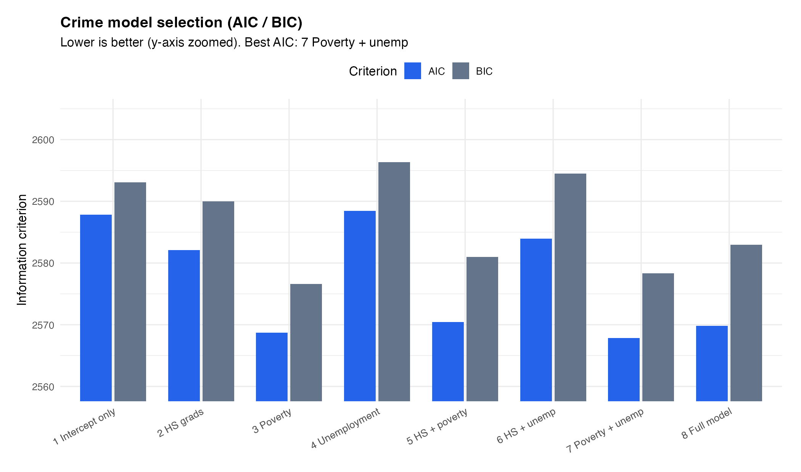
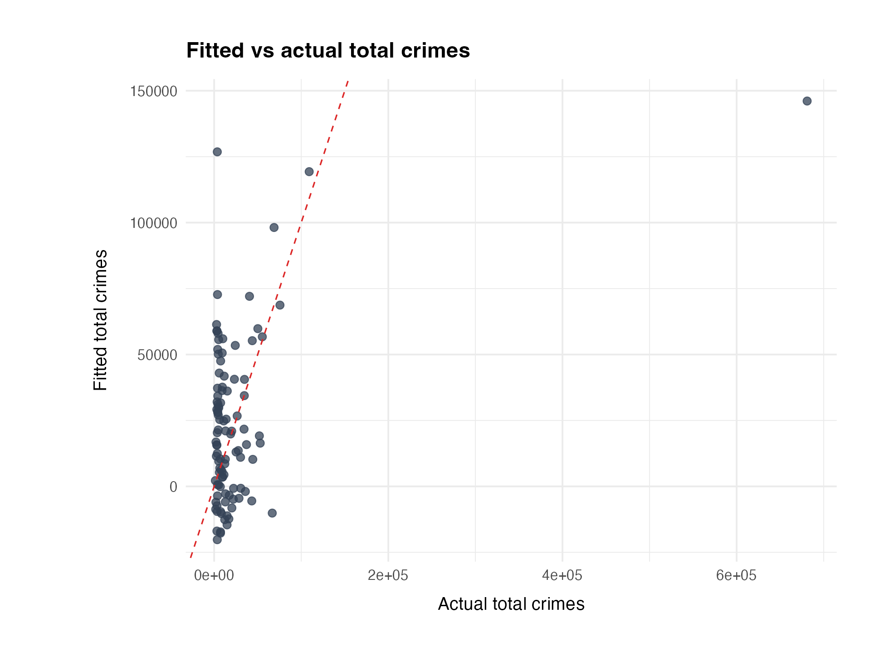
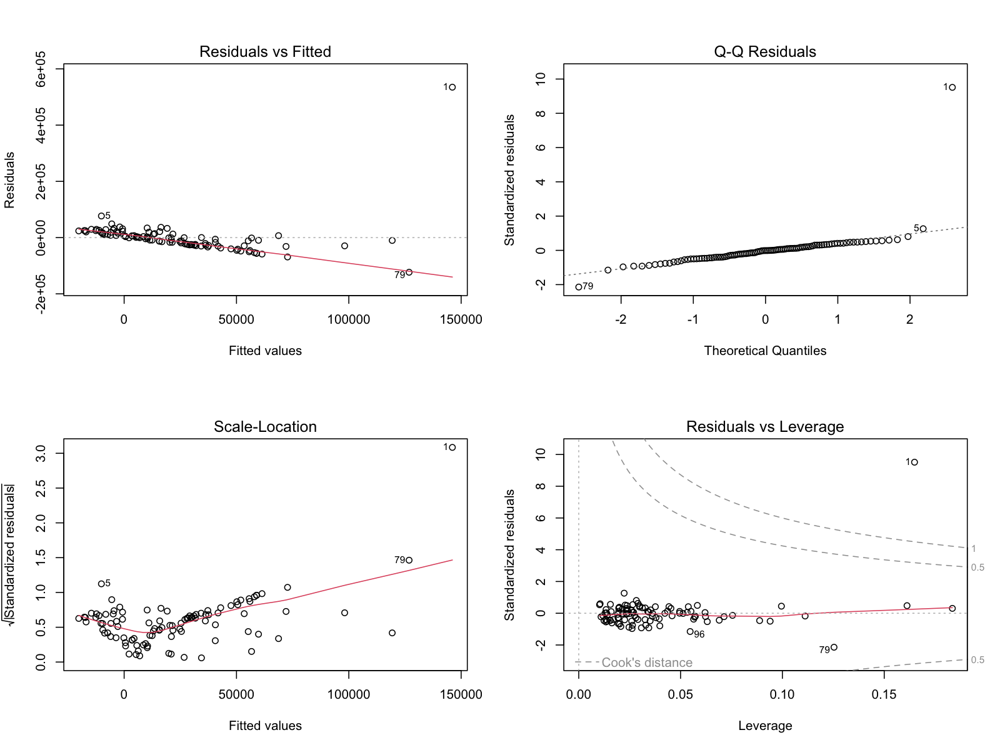

# Socioeconomic Predictors of Crime Rates

## Overview
This project analyzes the relationship between socioeconomic factors and total crime rates using multiple linear regression in R. The goal was to identify which demographic variables most strongly predict crime rates and evaluate model performance using statistical diagnostics.

## Research Question
Which socioeconomic indicators are the strongest predictors of total crime rates?

## Dataset
The dataset contains demographic and socioeconomic variables including:
- Percent high school graduates
- Poverty level
- Unemployment rate
- Total crime rate

## Methodology
- Conducted Exploratory Data Analysis (EDA)
- Built multiple linear regression models
- Compared models using:
  - ANOVA
  - AIC / BIC
  - Adjusted R²
- Performed residual diagnostics to assess model assumptions
- Evaluated multicollinearity and model validity

## Key Findings
- Poverty level was the most statistically significant predictor of total crime rate (p < 0.001).
- Models including poverty explained a substantial portion of the variability in crime rates.
- Diagnostic checks confirmed reasonable adherence to regression assumptions.

## Screenshots

### Pairs plot

Region 1 pairwise relationships across crimes and predictors.

### Poverty scatter

Total crimes vs percent below poverty level.

### Model selection

AIC and BIC across eight candidate regressions. Lower values are preferred.

### Fitted vs actual

Multiple regression fitted values against observed crimes.

### Residual diagnostics

Standard lm diagnostic plots for the selected crime model.

## Tools Used
- R
- ggplot2
- Base R regression functions

## Skills Demonstrated
- Linear Regression
- Model Selection (AIC/BIC)
- ANOVA
- Residual Analysis
- Data Visualization
- Statistical Interpretation

## How to Run
1. Open `Crime Rate Model.R` in RStudio
2. Ensure the dataset is in the same directory
3. Run the script

---

## Author
Roy Ho  
B.S. Statistical Data Science – UC Davis
